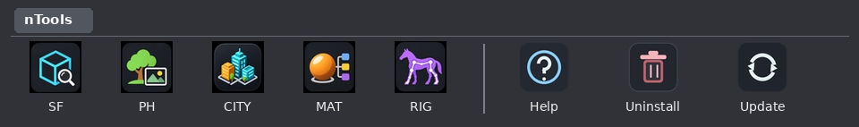

# nTools v1.0.8

Maya向け授業用ツールセット。Windows / macOS、Maya 2027（Arnold / OpenPBR利用環境）を想定。実機での動作確認は配布前に行ってください。



## ツールの使い方（学生向け）

アイコンまたはツール名をクリックすると、日本語の操作マニュアルを開けます。実際のUIに合わせた手順、設定の意味、よくあるエラーを掲載しています。

| アイコン | ツール・操作マニュアル | バージョン | 機能 |
|---|---|---|---|
| [](docs/tools/sketchfab.md) | [Sketchfab Asset Browser](docs/tools/sketchfab.md) | 1.2 | 静的glTFモデルの検索・インポート、OpenPBR |
| [](docs/tools/polyhaven.md) | [PolyHaven Asset Browser](docs/tools/polyhaven.md) | 5.2 | モデル・テクスチャ・HDRI、ローカルライブラリ |
| [](docs/tools/city_builder.md) | [Maya City Builder](docs/tools/city_builder.md) | 2.4.1 | OSM / PLATEAU / Procedural / 日本風の街並み生成 |
| [](docs/tools/material_creator.md) | [Material Creator](docs/tools/material_creator.md) | 1.3 | ローカルテクスチャ / JSONからOpenPBR作成 |
| [](docs/tools/quadruped.md) | [Quadruped Quick Rig](docs/tools/quadruped.md) | 2.4.0 | 四足ガイド、IK/FK、試験的なリターゲット |

> v1.0.5では各ツール右上にHelpを追加し、シェルフにHelpを追加しました。既存4ツールのマニュアルに操作図・GIF・MP4を掲載しています（実機キャプチャではありません）。v1.0.7でRIGとHelpの間にSeparatorを追加しました。v1.0.8ではCITYをMATの左に追加します。v1.0.3〜1.0.7からはUpdate → Maya再起動 → Update（もう一度）で移行できます。管理コードの実行は不要です。

## 初回導入（学生）

1. [GitHub](https://github.com/nmasaaki-web/nTools) の Code → Download ZIP を選択し、展開する。
2. Mayaを起動し、Fileメニュー・メニューセット・シェルフが正常に表示されていることを確認。作業中のシーンを保存する。
3. 展開した `install.py` をMayaのビューポートへドラッグ＆ドロップ。確認画面で **Install + Shelf** を選ぶと、未登録ならnToolsシェルフを作成し、既知の旧構成なら不足するCity Builder・管理ボタン・Separatorだけを追加する。**Files Only** は本体だけを導入する（安全確認用）。
4. 初回導入は再起動不要。nToolsタブを選び、5ツール、Separator、Help、Uninstall、右端Updateをすぐに使用できる。初回の実機検証では後から再起動してシェルフの保持も確認する。

ドラッグできない場合はScript Editorの **Python** タブで実行し、展開した `install.py` を選択：

```python
import maya.cmds as cmds
import runpy
p = cmds.fileDialog2(fileMode=1, fileFilter='Python (*.py)', caption='Select nTools install.py') or []
if p:
    runpy.run_path(p[0], run_name='__main__')
```

## 旧版 v1.0.0〜1.0.2 からの移行（重要）

旧版のUpdateはシェルフを再登録するため、**旧版のUpdateを押さず**、v1.0.8のZIPをダウンロードして上記のインストールを行う。まずFiles Onlyを選択し、Mayaを再起動してUIが正常か確認することを推奨。Files Onlyでは既存のnToolsシェルフを変更しない。再起動後、正常な既知のシェルフならUpdateで不足するCity Builder・管理ボタン・Separatorを追加できる。タブがない場合は次のRepair Shelfを実行する。

## 管理・修復・アンインストール

通常はシェルフ右端の **Update** だけで更新できます。下の管理コードは修復などの必要時にのみ、Maya Script EditorのPythonタブで実行：

```python
import sys
import maya.cmds as cmds
p = cmds.internalVar(userScriptDir=True)
if p not in sys.path:
    sys.path.insert(0, p)
from ntools import installer as nt
nt.manage()
```

- **Update**：GitHub mainの新しいバージョンを確認して本体を更新。最新版の場合も既存シェルフを確認し、既知の構成なら不足するCity Builder / Help / UninstallとSeparatorを追加して順序を整える。シェルフ全体は再構築しない。本体が更新された場合のみ再起動が必要。
- **Repair Shelf**：シェルフが存在しないときにだけ登録。既存タブは変更しない。既存のタブを作り直したい場合はMaya標準のShelf EditorでnToolsのみを削除・保存し、再起動してからRepair Shelf。既存のシェルフファイルが残っている場合は安全のため中止する。
- **Add Help Button**：管理用の手動同期（通常はUpdateで不要）。CITYをMATの左に追加し、RIG → Separator → Help → Uninstall → Updateの順にする。元の4ツールと他のシェルフは変更しない。
- **Add Uninstall Button**：旧管理メニューとの互換用。Add Help Buttonと同じ管理ボタン同期を行う。
- **Uninstall**：安全のため自動でシェルフを削除しません。ボタンを押すと、Maya標準のShelf EditorでnToolsタブだけを削除し、Save All Shelvesで保存・再起動する手順を案内します。案内ウィンドウには本体削除用のPythonコードを独立した欄で表示し、右側の「コピー」でコードだけをコピーできます。再起動前にメモ帳などへ保存し、再起動後にScript EditorのPythonタブへ貼り付けて実行してください（管理画面のUninstall選択は不要）。登録情報とシェルフファイルが残っていないことを確認し、最終確認後に本体をバックアップに移動します。他のシェルフやプロジェクトは変更しません。

Updateは本体更新に加え、必要な場合だけCity Builder・管理ボタン・Separatorを同期します。Uninstallは2段階の案内方式です。

初回導入で既存の本体がない場合は再起動不要です。既存本体の更新・アンインストール後は、旧モジュールが残るため再起動が必要です。

本体削除用コード（案内ウィンドウのコピー内容）：

```python
import sys, maya.cmds as cmds
p = cmds.internalVar(userScriptDir=True)
if p not in sys.path: sys.path.insert(0,p)
from ntools import installer as nt
nt.uninstall()
```


## v1.0.3〜1.0.7からの移行（スクリプト不要）

1. GitHubにv1.0.8が公開されている状態で、既存のシェルフ右端のUpdateを押す。
2. 本体更新後、Mayaを再起動する。旧版の更新処理はCITYの追加を知らないため、シェルフ構成不一致と表示されることがある。本体更新が完了していれば再起動後のUpdateで移行できる。
3. **Updateをもう一度押す。** 本体が最新版でも不足するCity Builder・管理ボタン・Separatorを確認・追加する。SF → PH → CITY → MAT → RIG → Separator → Help → Uninstall → Updateの順になる。この操作だけなら再起動不要。

既にv1.0.8を読み込んでいる場合、Updateの1回の操作で本体更新とシェルフの同期を行う。新規導入は最初から8ボタンと1個のSeparatorを登録する。

カスタムボタンや未知のツール構成がある場合、自動同期を中止して本体を保持する。今回のCity Builder追加のみ自動移行対象。未知のツール追加・削除は対象外。

## 動画・実機撮影

既存4ツールのマニュアルには4ステップの操作図、GIF、MP4があります。City Builderは日本語の操作手順とモード別ガイドを掲載しています。Material CreatorはFabのQuixel Megascans Stone Surfaceを題材にしています。実際の素材を使うデモスクリプト、実機撮影とYouTube公開の手順は [撮影・実機検証ガイド](docs/capture_guide.md) を参照。素材本体は含みません。

## 利用時の注意

- File → Set Project を行ってからアセットやマテリアルを読み込む。
- SketchfabのAPIトークンは各自取得し、公開リポジトリに保存しない。モデルごとのライセンス・作者表示を確認。アニメーションやスキンは未対応。
- Poly Haven・Material CreatorはArnold / OpenPBRが必要。アセットの種類によってFBX等のプラグインが必要。
- City Builderのオンライン地図・OSM・PLATEAU・GSIはネット接続が必要。まず200〜500 mの小範囲で試す。PLATEAUは日本のみ、データが大きい場合は数GB以上の空き容量を確保。地図データの出典・利用条件を守る。
- 四足リグはMotionMaker/HumanIK認定リグではない。転送は試験的機能。必ずシーンのコピーで試す。
- Updateはインターネット接続が必要。学内プロキシ等で失敗した場合は新ZIPから手動導入する。

## 安全性と復旧

v1.0.8は通常更新でシェルフを再構築せず、Maya.env、userSetup、メニューセット、ワークスペース、他のシェルフを直接編集しない。シェルフ登録・削除の直前にメニュー状態を確認し、関連する設定ファイル（存在するもの）をコピーして保存する。Mayaの標準処理による設定変更はあり得る。

本体はMayaのユーザースクリプトディレクトリ内の `ntools` に保存。バックアップは同じ親フォルダ内の `.ntools-backup-*`、`.ntools-uninstalled-*`、`.ntools-ui-backups`。バックアップを自動で削除しない。シェルフ登録失敗時は本体を保持し、UIを自動削除・全設定復元しない。

UIがおかしくなった場合は操作を中止し、Mayaの再起動・標準のメニューセット復元を試す。設定をリセットする場合は、Mayaを終了してから設定フォルダを削除ではなく名前変更してバックアップする。詳しくは [管理者向けガイド](docs/maintainer.md)。

公開コードを信頼できることを確認してからインストールしてください。SHA-256は配布内の整合性検証であり、署名による作者認証ではありません。

## v1.0.0〜1.0.2の起動エラー復旧（重要）

旧版では `saveShelf` に `.mel` 付きのパスを渡していたため、二重拡張子のシェルフができる可能性があります。`nTools.mel` タブや `Object 'nTools.mel' not found` が出る場合は、旧版を再実行しないでください。

1. Mayaを終了し、2027の設定フォルダをバックアップ。
2. `prefs/shelves` 内のnTools関連ファイル（`shelf_nTools.mel`、`shelf_nTools.mel.mel`、`.deleted` 等）を設定フォルダ外へ移動。他のシェルフは移動しない。
3. `prefs/userPrefs.mel` を設定フォルダ外へ退避して再起動。必要なら `prefs` 全体を名前変更して初期化。設定が一部初期化されるのでバックアップを保持。Maya.envは削除不要。
4. UIが正常に戻った後、v1.0.8の `install.py` からFiles Onlyで導入し、再起動。その後Repair Shelfを実行し、再起動して検証。旧版のUpdateは使わない。

新版は拡張子なしのパスを `saveShelf` に渡し、期待したファイルの存在と異常なシェルフ名を検査します。実際のMaya 2027.2での確認が完了するまでは学生に配布しないでください。
