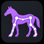

# nTools — Maya Tools for CG Classes

Maya 2027 を主な対象とする、3DCG演習用ツール集です。Windows / macOS のユーザー環境に nTools シェルフを登録し、4つのツールをまとめて起動・更新できます。


## 収録ツール

| アイコン | ツール | バージョン | 概要 |
|---|---|---|---|
|  | Sketchfab Asset Browser | 1.2 | Sketchfabの検索・サムネイル表示・静的glTFのインポート、OpenPBR |
|  | PolyHaven Asset Browser | 5.2 | Poly Havenアセット、HDRI、ローカルライブラリ、OpenPBR |
|  | Material Creator | 1.3 | ローカルテクスチャ／JSONからOpenPBRマテリアル作成・アサイン |
|  | Quadruped Quick Rig | 2.4.0 | 馬・犬・狼・猫のガイド、IK/FKリグ、試験的なモーション転送 |
|  | Update | — | GitHub mainのパッケージ更新確認・導入 |

## 学生向け：最初のインストール（Windows / macOS）

1. [nToolsをZIPでダウンロード](https://github.com/nmasaaki-web/nTools/archive/refs/heads/main.zip)（またはこのページの Code → Download ZIP）。
2. ZIPを展開する。ZIPの中から直接実行しないこと。
3. Maya 2027を起動し、展開したフォルダの `install.py` をMayaのビューポートへドラッグ＆ドロップする。
4. 確認ダイアログで **Install** を選択する。
5. シェルフに **nTools** タブが追加される。SF、PH、MAT、RIG、Updateの順に並ぶ。

ドラッグ＆ドロップで動かない場合は、Mayaの Script Editor を開き、**Python** タブに次のコードを貼って実行する。ファイル選択で展開済み `install.py` を指定する。

```python
import maya.cmds as cmds
import runpy
p = cmds.fileDialog2(fileMode=1, fileFilter='Python (*.py)', caption='Select nTools install.py') or []
if p:
    runpy.run_path(p[0], run_name='__main__')
```

- インストールはMayaのユーザースクリプトディレクトリに行う。管理者権限、Git、pipは不要。
- 他のシェルフ、シーン、プロジェクトフォルダは変更しない。nToolsタブのみ管理対象とする。
- 初回導入後はシェルフを保存するため、Mayaを起動し直しても利用できる設計。
- 大学のPCでユーザープロファイルが初期化される場合は、再インストールが必要。

## 学生向け：アップデート

1. シーンを保存して、ツールの処理を終了する。
2. nToolsシェルフの一番右にある **Update** をクリックする。
3. GitHubに新しいパッケージバージョンがあれば確認画面で **Update** を選択する。
4. 更新完了後、Mayaを再起動する。

最新版ならその旨を表示する。通信や検証が失敗した場合は、既存のツールを維持する。更新はインストール済みnToolsのみ対象。自動的にバックグラウンド更新は行わない。

## 使用上の注意

- Maya 2027を推奨。OpenPBRとArnold/MtoAを使用する機能がある。必要に応じてFBX/OBJプラグインも使用する。
- Sketchfabのダウンロードには自分のAPIトークンが必要。トークンを公開リポジトリ、課題提出物、他人と共有しない。各アセットのライセンス・作者表記に従う。静的glTFのみ対象で、一部拡張、圧縮、リグ、アニメーションは非対応。
- PolyHaven/Material Creatorでは、テクスチャをプロジェクトへコピーする場合、事前に File → Set Project を実行する。
- Quadruped Quick RigはMotionMaker/HumanIKの正式なキャラクター定義ではない。転送は試験的な機能で、足の接地や解剖学的な一致を保証しない。コピーしたシーンで試すこと。
- 個別ツールは提供されたオリジナルのスクリプトをそのまま収録。Maya 2027上の統合インストール・更新処理は実機での確認が必要。
- macOSのアップデート通信ではシステムcurlを利用し、SSL証明書の検証を無効化しない。

## 教員向け：更新方法

[管理・公開手順](docs/maintainer.md)を参照してください。

## 配布について

本リポジトリは授業用ツールの配布を目的とします。個別のアセットは同梱していません。Sketchfab、Poly HavenおよびAutodeskは各権利者に帰属します。第三者の公式製品ではありません。公開リポジトリの閲覧可否とコードの再利用・再配布の許諾は別です。ライセンスは管理者が確定のうえ追加してください。
