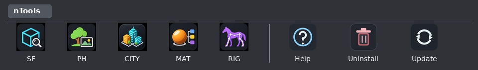

# Maya City Builder v2.4.1

[← nTools トップへ戻る](../../README.md)

地図の範囲から、編集可能な街並みをMaya内に生成するツールです。OpenStreetMap（OSM）、国土交通省のProject PLATEAU、国土地理院（GSI）の標高データを利用できます。Procedural Japanでは、地図の建物・道路配置に日本風のディテールを追加します。

> v2.4.1はnTools統合版です。添付元v2.4の地理データ取得・メッシュ生成処理を維持し、起動方法とHelpを追加しました。Maya 2027を想定しています。実機でのオンライン取得・生成は利用環境と公開サービスの状況に依存します。

## 1. 最初の使い方（クイックスタート）

1. Mayaでシーンを保存し、必要に応じて **File → Set Project** を実行します。Y-upのシーンを使います。
2. nToolsシェルフの **CITY** を押します。ウィンドウ右上の **Help** はこのページを開きます。
3. `Mode` を **OSM** にし、`1. 地図を開く / Open Map` を押します。ブラウザに地図が表示されます。
4. 地図を拡大し、**範囲選択（2点）** を押して、取り込みたい長方形の対角を2点クリックします。最初は200〜500 m程度の小さな範囲がおすすめです。
5. ブラウザの **選択範囲をMayaへ送信** を押します。Mayaに戻り `2. 選択範囲を取得 / Receive Selection` を押し、South / West / North / East の値が更新されていることを確認します。
6. `Layers / 生成する要素` を選択します。まずはBuildings、Roads、GroundをONにし、必要に応じてWater / Green areasをONにします。`Japan DEM terrain` は初回OFFにしておくと手軽です。
7. `Material` を **OpenPBR**（対応環境）または **Standard Surface** に設定します。`3. BUILD CITY / 街並みを生成` を押します。
8. ステータス欄とScript Editorで進捗を確認します。完了すると生成した都市のルートが選択されます。ビューポートでFキーを押してフレームし、Outlinerで内容を確認します。

### 地図が開けない場合

座標を直接入力できます。入力順は **南 / 西 / 北 / 東（緯度・経度、十進度）** です。例（東京駅周辺、ツールの初期座標）：

| 入力欄 | 値 |
|---|---:|
| South / 南 | 35.6788 |
| West / 西 | 139.7645 |
| North / 北 | 35.6834 |
| East / 東 | 139.7701 |

南 < 北、西 < 東であることを確認。各辺5 m以上、1.5 km以下、緯度±80°以内で、日付変更線をまたぐ範囲は不可です。地図タイルの読み込みができなくても手入力は可能ですが、オンラインの地理データ取得にはインターネット接続が必要です。

## 2. 生成モードの選び方

| Mode | 何ができる？ | おすすめの用途 |
|---|---|---|
| OSM | 建物を輪郭と高さから立体化。道路、水面、緑地をポリゴン生成 | 低負荷の背景・レイアウト |
| PLATEAU | 日本の公開CityGMLのLOD1/LOD2建物を読み込み。対応する写真テクスチャも利用可能 | 実在都市の形状を活用したい場合 |
| Procedural | OSM建物に窓、玄関、屋根の縁などを追加 | 近景の街並みを手早く作成 |
| Procedural Japan | OSMをベースに日本風の屋根・建物装飾・道路沿いの設備を追加 | 住宅街・駅前など日本風の背景制作 |

### OSM / Procedural 共通設定

- `Default building height (m)`：高さ情報・階数情報のない建物に使う推定高さ（初期値9 m）。
- `Height per floor (m)`：OSMの階数から高さを推定する際の階高（初期値3 m）。
- `Overpass URL`：OSMデータを取得するHTTPSのエンドポイント。通常は初期値のままで使用します。公開サービスの混雑時には範囲を縮小してから再試行してください。
- `Detail building limit`：Procedural / Procedural Japanで細部を追加する建物数の上限（初期値150、最大500）。上限を超えた建物は基本形状になります。詳細パーツ数にも内部上限があります。
- `Facade style`（Proceduralのみ）：Residential、Office、Industrialから選択します。

## 3. Procedural Japan：日本の街並みを作る

1. `Mode` を **Procedural Japan** に変更します。地図で日本の住宅街・駅周辺などを200〜300 m程度選択します。
2. Buildings、Roads、GroundをONにします。道路沿いの小物を生成するにはRoadsが必要です。
3. `District style` を選びます。
   - `Auto (OSM tags)`：OSMの用途・高さ・面積等から建物種別を推定。
   - `Residential district`：住宅・集合住宅を中心に生成。
   - `Urban / station district`：オフィス・集合住宅などを混ぜる設定。
4. `Random seed`（初期値42）を設定します。同じ地図データと設定なら装飾の乱数を再現しやすくなります。
5. `Utility pole spacing (m)`（初期値32）を設定し、必要なディテールにチェックを入れます。
6. `BUILD CITY` を押し、Outlinerの建物グループと `Japan_Street_Details` を確認します（生成できた小物がある場合）。

| チェック項目 | 生成内容 |
|---|---|
| Japanese roofs / 瓦屋根風・軒 | 矩形に近い住宅の切妻屋根・軒など。その他の建物は屋上の縁など |
| Windows, doors, signs | 窓枠、ガラス、入口、看板など |
| Apartment balconies | 集合住宅のバルコニー・手すり |
| Outdoor AC units | 室外機 |
| Utility poles / Overhead wires | 電柱・電線（電柱が必要） |
| Road center markings | 条件に合う道路のセンターライン |
| Guardrails | 条件に合う道路のガードレール（初期OFF） |
| Vending machines / Traffic signals | 自販機・信号機の簡易モデル |

**注意：** 屋根・窓・信号機・電柱・自動販売機などは実測データではありません。道路や建物との衝突を避けるための推定配置で、道路の種類・形状・空きスペースによって生成されないことがあります。日本風の制作素材として編集してください。実在都市の忠実な復元を目的とする場合はPLATEAUを検討してください。

## 4. PLATEAU：実在する都市モデルの読み込み

対象は日本です。`Mode` をPLATEAUにし、地図の対象範囲を設定します。`Buildings` はONにしてください。

### A. Online API

1. `Source` を `Online API` に設定。
2. `LOD` を `LOD2 preferred (fallback LOD1)` にするとLOD2を優先し、取得できる形状に応じてLOD1へフォールバックします。軽い形状が必要なら `LOD1 only` を選びます。
3. `Import photo textures when available` をONにすると写真付きZIPを試します。対象データにテクスチャと対応UVが含まれている場合に利用されます。ZIP取得に失敗すると個別CityGMLへ切り替わることがあり、その場合写真は取得されません。
4. `Keep PLATEAU buildings if OSM layers fail` をON（初期値）にすると、道路等のOSM取得が失敗しても、取得済みのPLATEAU建物を残して生成できます。
5. `BUILD CITY` を押します。データサイズが大きい場合はダウンロードと解析に時間がかかります。ステータスとScript Editorを確認してください。

### B. Online Direct GML (geometry only)

写真を必要としない場合は、このSourceを選択します。個別のCityGMLを直接取得します。写真テクスチャは取得されません。ファイル自体が大きいこともあるので、十分なディスク空き容量が必要です。

### C. Local CityGML / ZIP / folder（オンライン取得に失敗した場合におすすめ）

1. [PLATEAU公式オープンデータ](https://www.mlit.go.jp/plateau/open-data/)から、目的の都市の建物用CityGMLを取得します。必要に応じて利用規約を確認してください。
2. Mayaの `Source` を `Local CityGML / ZIP / folder` にします。
3. `Local path` の `File` または `Choose bldg folder / フォルダ選択` から、ZIP、GMLファイル、展開した建物（bldg）フォルダを指定します。
4. **ローカルの場合も地図範囲を設定** してください。指定範囲と重なる建物を選びます。範囲外に伸びる建物を厳密に切断する処理ではありません。
5. LOD・テクスチャを設定して `BUILD CITY` を押します。写真を使う場合は元のGMLと画像の相対的なフォルダ構造を保持します。

このツールは主にPLATEAUのEPSG:6697（緯度・経度・標高）の3次元CityGMLを想定しています。LOD1/LOD2の建物形状に対応しますが、全CityGML仕様・穴のある面・メンバーをまたぐ参照等に完全対応するものではありません。ローカル建物のみでネット接続を使いたくない場合はRoads、Water、Green areasとDEMをOFFにします。地図範囲は手入力できます。

## 5. 地形・マテリアル・生成結果

- `Japan DEM terrain`：国土地理院の標高タイルを利用する日本向けオプション。GroundをONにする必要があります。`DEM grid interval (m)` は初期値15 m（5〜100 m）。細かくするとポリゴン数が増えます。欠損値は近似される場合があり、道路や地形が実測どおりになる保証はありません。
- `Material`：OpenPBRを優先できます。利用できない場合はStandard Surface、さらに利用できない場合はLambertへフォールバックする実装です。写真付き建物のマテリアルは取得できた画像とUVに依存します。
- 生成物はOutlinerの `City_OSM...`、`City_PLATEAU...`、`City_Procedural...`、`City_Procedural_Japan...` 等の新規グループに整理されます。建物は個別メッシュ、道路・水面・緑地などはレイヤーごとのメッシュです。`Select last city root` で直近の生成ルートを選択できます。
- 都市の中心を原点とするローカル座標。Xが東、Yが上、-Zが北。1 mをMaya内部の100 cmに変換しています。大きな街の表示ではカメラのクリッピングやフレームを調整してください。
- 不要な都市はOutlinerで対象の都市ルートだけを選んで削除してください（マテリアル等の未使用ノードは別途整理）。既存のシーン全体を削除する操作は必要ありません。

## 6. トラブルシューティング

| 症状 | 対処 |
|---|---|
| 地図を開けない、地図ライブラリが読み込めない | ブラウザ、学内ネットワーク、Leaflet/CDN、OSMタイルへの接続を確認。座標を直接入力する |
| 選択範囲がMayaに届かない | ブラウザの「選択範囲をMayaへ送信」の成功表示を確認してからReceive Selection。古いブラウザタブは閉じてOpen Mapをやり直す |
| `Select an area between 5 m and 1.5 km` | 範囲を小さく、または極端に細長くならないよう設定 |
| `Y-up Maya scenes only` | MayaのUp AxisをYに設定したシーンで実行 |
| OverpassのHTTP 429 / 503 / timeout | 公開サービスの混雑等。範囲を200〜300 mに縮め、時間を空ける。連続大量リクエストは避ける |
| PLATEAU Pack failed / download size limit | ステータスとScript Editorを確認。Direct GMLへ切り替えるか、必要タイルのみをローカル取得。ディスクの空き容量も確認 |
| `No LOD1/LOD2 buildings found` | 範囲と対象都市、建物用GML、CRS・LODを確認 |
| 写真テクスチャがない | Direct GMLは写真なし。ZIP/ローカルの画像の有無・相対パスとImport photo textures設定を確認 |
| `More than 2000 buildings` / geometry limit | 範囲を縮小。詳細建物数やProceduralのチェック項目も減らす |
| MacでSSL/TLSエラー | システムcurlによる検証付きHTTPSフォールバックを実装済み。ネット接続・証明書・学内プロキシを確認し、詳細ログを教員へ共有 |

### 容量とキャッシュ

オンラインデータはMayaユーザーアプリディレクトリ配下の `maya_city_builder_cache` に保存されます。OSMのキャッシュ、PLATEAUカタログ・ZIP・GML、テクスチャ、DEM等が含まれます。PLATEAUの安全上限はZIP 8 GiB、GML 1ファイル4 GiB、GML合計16 GiB、最大2,000建物・25万面です。上限内でも実機のRAMやディスク容量により重くなる場合があります。小範囲から試し、十分な空き容量を確保してください。

PLATEAUの写真テクスチャはキャッシュ内の画像やローカル元画像を参照することがあります。キャッシュを消す前にMayaのFile Path Editor等で参照を確認し、制作物の提出時は必要画像をプロジェクトへコピーしてパスを整理してください。nToolsのアンインストールはこのキャッシュや制作シーンを削除しません。

## 7. 出典・利用条件

生成ルートには、範囲・原点・使用したデータのクレジット（`cityCredits`）が保存されます。作品の配布・公開時にも必要な出典表示と利用条件を確認してください。

- [OpenStreetMap contributors / ODbL](https://www.openstreetmap.org/copyright)
- [Project PLATEAU / 国土交通省](https://www.mlit.go.jp/plateau/)
- [国土地理院 標高タイル](https://maps.gsi.go.jp/development/demtile.html)

地図データや写真テクスチャそのものはnToolsの公開リポジトリに同梱していません。公共APIの利用条件と素材ごとのライセンスに従ってください。Google Mapsのデータは使用していません。

[← nTools トップへ戻る](../../README.md)
