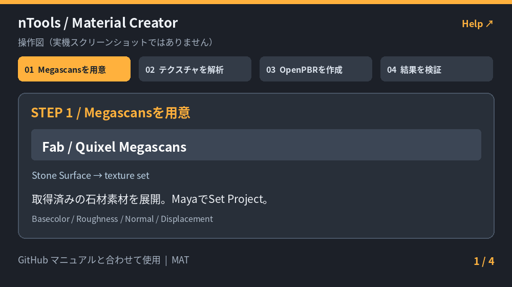

# Material Creator v1.3

[← nTools トップへ戻る](../../README.md)

ローカルのテクスチャフォルダまたはJSONからOpenPBRマテリアルを作成します。FBXなどのモデル本体をインポートする機能ではありません。

## クイックガイド（図解・GIF・動画）

ウィンドウ右上の **Help** からこのページを開けます。

[静止画 STEP 1](../media/material_creator/step-1.png) · [STEP 2](../media/material_creator/step-2.png) · [STEP 3](../media/material_creator/step-3.png) · [STEP 4](../media/material_creator/step-4.png) · [MP4動画を開く／ダウンロード](../media/material_creator/quick-guide.mp4)

> 図解・GIF・MP4は実際のソースコードのボタン名・設定に基づく操作説明です。Mayaの実機キャプチャや実行結果ではありません。

## 1. 準備

- Arnold / OpenPBRを利用できるMayaで、File → Set Projectを実行します。
- ダウンロード済みアセットを展開し、1つの素材に対応するテクスチャフォルダ（必要ならJSON）を用意します。
- nToolsシェルフの **MAT** をクリックします。

## 2. テクスチャフォルダから作成する

1. `Input type` を `Texture Folder` に設定します。
2. `Browse…` で対象のフォルダを指定します。パスを手入力した場合は `Scan` を押します。
3. フォルダ直下にJSONがある場合は、使用するか確認されます。「はい」でJSONを利用、「いいえ」でファイル名を基にフォルダを解析します。複数JSONがある場合は候補を選べます。
4. `Texture set`、`Texture Tier`、`Texture resolution` を選び、下のプレビューに表示されたBase Color、Roughness、Normal等のファイルを確認します。
5. Mayaで割り当て先のポリゴンメッシュまたはフェースを選択します。
6. `Assign to Selection` と `Copy textures to Maya project` をONにし、`CREATE OPENPBR / ASSIGN` を押します。
7. Set Projectの確認に回答し、作成後HypershadeやArnold RenderViewで結果を確認します。

マテリアルだけ作りたい場合は `Assign to Selection` をOFFにします。ボタンが `CREATE OPENPBR MATERIAL ONLY` に変わります。

## 3. JSONから作成する

1. `Input type` を `JSON File` にします。
2. `Browse…` からアセットのJSONを指定します。対応する画像が同じアセットのフォルダ内にある必要があります。
3. `Texture set`、Tier、解像度と検出されたマップを確認し、上記と同様に作成します。

Fab/MegascansのマルチTierのJSONにも対応していますが、JSONの記載とダウンロード済み実ファイルの対応が必要です。JSONが利用できない場合、ツールは理由を表示してフォルダ解析に切り替えることがあります。作成中のエラーを安全に取り消せない場合は自動再試行しません。

## 4. 設定の意味

| 設定 | 役割 |
|---|---|
| Texture set | 同じ素材に属するテクスチャの組を選択。 |
| Texture Tier | 初期Auto。Base ColorのそろったTierを優先。明示選択も可能。 |
| Texture resolution | 初期2K。使用する画像の解像度を選択。 |
| Normal convention | Auto / OpenGL / DirectX。法線マップの向きに合わせる。 |
| Assign to Selection | 初期ON。選択メッシュまたはフェースに適用。 |
| Copy textures to Maya project | 初期ON。プロジェクト内へテクスチャをコピー。 |
| Enable Displacement | 初期OFF。高さマップで凹凸を設定。 |
| Height (scene units) / Height midpoint / Subdivision iterations | 初期0.2 / 0.5 / 2。Displacement有効時に調整。 |

### 実習：Quixel Megascans の石材を使う

対象例：[Stone Surface — Quixel Megascans (Fab)](https://www.fab.com/listings/c6896470-a380-4d10-a39e-4e82cd606bae?lang=en)。掲載情報には Basecolor、Roughness、Normal、Displacement 等が含まれます。取得資格・価格・ライセンスはFabで確認してください。素材そのものはこの公開リポジトリに同梱しません。

1. Fabで取得済みの素材の **texture set** をダウンロードし、展開します（別の取得済みMegascans石材でも可）。[Fab公式ダウンロード手順](https://dev.epicgames.com/documentation/ja-jp/fab/purchasing-and-downloading-assets-in-fab) を参照。
2. Mayaで新規のテストシーンを用意し、File → Set Project。Create → Polygon Primitives → Sphere でUV付きの球を作成します。
3. MATを起動し、Texture Folder → Browse… で取得したフォルダを選択。JSONがあれば選択可能。Scan後にBase Color、Roughness、Normalを確認。
4. Texture TierはAuto、解像度2K、Assign to SelectionとCopy textures to Maya projectをON、Enable DisplacementをOFFにします。実ファイルの解像度が異なる場合はプレビューの表示を優先します。
5. 球を選択し、CREATE OPENPBR / ASSIGN。Set Project確認に回答します。
6. HypershadeでopenPBRSurfaceへの接続を確認し、Arnold Skydome Light等を用意してArnold RenderViewで確認します。
7. 追加実習：実際にHeightマップが存在する場合だけEnable DisplacementをONにし、Heightを小さめから調整して比較します。

**自動デモ（教員向け）：** [megascans_material_demo.py](../examples/megascans_material_demo.py) をMayaで実行すると、手元の正規取得済み素材を選択し、実際のMaterial Creatorの処理でテスト球にOpenPBRを作成できます。手順は [撮影・実機検証ガイド](../capture_guide.md) を参照。この環境では素材の取得・Mayaでの実行・レンダー撮影は行っていません。

## 5. よくある問題

| 症状 | 対処 |
|---|---|
| マテリアルアサイン先のオブジェクトが選ばれていません | メッシュ・フェースを選択するか、Assign to SelectionをOFF。 |
| Base Colorが見つかりません | 選択フォルダ、Texture set、Tier、JSONの参照先を確認。必要ならAuto TierまたはTexture Folderで再解析。 |
| Normalが逆に見える | OpenGL / DirectXの設定を元の画像に合わせる。 |
| Displacementが大きすぎる | Enable DisplacementをOFFにするか、Heightを小さく調整し、シーン単位を確認。 |
| 他のPCでテクスチャが消える | Set Projectを正しく設定し、Copy textures to Maya projectを使う。sourceimagesも一緒に移動。 |

Base Colorが必要です。AOはBase Colorへ自動で乗算されません。素材によっては特殊なマップが接続されないため、ログとHypershadeで確認してください。素材ファイルの利用条件は入手元に従ってください。

[← ツール一覧へ](../../README.md) · [Quadruped Quick Rig →](quadruped.md)
