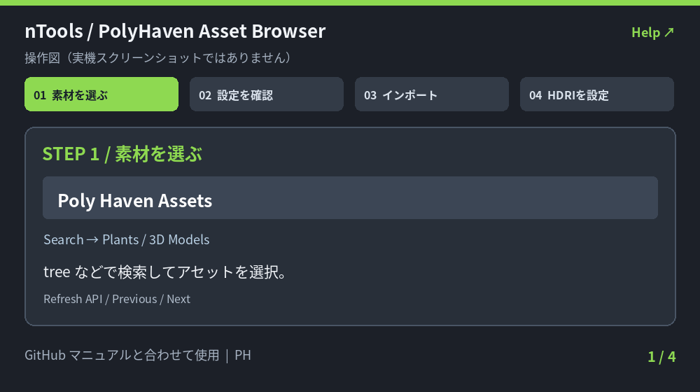

# PolyHaven Asset Browser v5.4.2

[← nTools トップへ戻る](../../README.md)

Poly Havenのモデル、植物、サーフェス、HDRIをMayaから検索・取得し、OpenPBRやArnoldライトを設定します。ダウンロード済みのローカルアセット（FBX/OBJ、テクスチャ等）も扱えます。

## クイックガイド（図解・GIF・動画）

ウィンドウ右上の **Help** からこのページを開けます。

[静止画 STEP 1](../media/polyhaven/step-1.png) · [STEP 2](../media/polyhaven/step-2.png) · [STEP 3](../media/polyhaven/step-3.png) · [STEP 4](../media/polyhaven/step-4.png) · [MP4動画を開く／ダウンロード](../media/polyhaven/quick-guide.mp4)

> 図解・GIF・MP4は実際のソースコードのボタン名・設定に基づく操作説明です。Mayaの実機キャプチャや実行結果ではありません。

## 1. 準備

Mayaで **File → Set Project** を実行し、シーンを保存します。Arnold / OpenPBRが使用できる環境で、nToolsシェルフの **PH** を押します。オンライン機能にはインターネット接続が必要です。Poly Havenの公開APIを使用し、個人APIトークンの入力はありません。

## 検索欄の使い方（v5.4.2）

検索欄は**各タブの直下に1つだけ**です。`Local Library`、`Poly Haven Assets`、`Poly Haven HDRIs` の切り替え後も、入力した `tree` / `wood` / `sunset` などの文字は維持されます。検索欄右端の×で文字をクリアできます。

同じ行にあるカテゴリフィルターでは、`All` / `3D Models` / `Plants` / `Surfaces` を選択できます。HDRIタブではHDRIしか表示されないため、カテゴリは一時的に非表示になります。オンラインでカタログが読み込めないときは `Refresh API` を試してください。ローカルファイルを追加した場合は上部の `Refresh` を押します。

## 2. モデル・植物を読み込む

1. `Poly Haven Assets` タブを選択します。
2. 検索欄に `tree`、`rock` などを入力し、必要に応じて `3D Models` / `Plants` / `Surfaces` で絞り込みます。`Previous` / `Next` でページ移動します。
3. サムネイル一覧からアセットを選びます。
4. 右側の `Mesh LOD / Tier` と `Texture resolution` を設定します。授業ではまず初期値のLOD 1・2Kを推奨します。
5. `Copy textures to Maya project` をONにしたまま、インポートボタン `DOWNLOAD & IMPORT` を押します（ローカルでは `IMPORT / CREATE OPENPBR`）。
6. Set Projectの確認画面が出たら、表示されたプロジェクトを確認して「はい」。ダウンロード・インポート完了後、形状とマテリアルを確認します。

オンラインのLODはLODラベル付きファイルがある場合に有効です。指定解像度・LODがない場合は利用可能な近い候補が選ばれることがあります。ログで実際のファイルを確認してください。

`Download only` は取得のみ行い、後からローカルライブラリで読み込む場合に便利です。`Cancel download` はダウンロードのキャンセル、`Open asset page` は元サイトの確認に使います。ダウンロード中にシーンやプロジェクトを変更すると、自動インポートが省略される場合があります。

## 3. サーフェス（床・壁等）を作成する

1. Mayaでマテリアルを割り当てるポリゴンメッシュまたはフェースを選択します。
2. `Poly Haven Assets` の `Surfaces` からテクスチャ素材を選択します。
3. `Surfaces: assign to selection` をONにしてインポートします。
4. 生成されたOpenPBRとテクスチャの接続をHypershadeで確認します。

割り当て先がない場合は処理を中止する警告が表示されます。マテリアルだけ生成したいときは `Surfaces: assign to selection` をOFFにしてください。

## 4. HDRIで照明を作る

1. `Poly Haven HDRIs` タブを選択し、空や屋外のHDRIを探します。
2. `HDRI resolution`（初期4K）、`Exposure (EV)`、`Rotation (degrees)` を設定します。
3. `Visible in camera` で背景として見せるかを設定します。`Replace selected / first existing Skydome` は初期ONです。既存のSkydomeを変更したくない場合はOFFにします。
4. `DOWNLOAD & CREATE SKYDOME` を押し、プロジェクトを確認します。Arnold Skydome Lightが作成、または既存の編集可能なSkydomeが更新されます。
5. Arnold RenderViewで確認し、明るさや向きを調整します。

ローカルの `.exr` / `.hdr` は `Import local EXR / HDR…` から読み込めます。HDRIはモデルのコピー設定にかかわらずプロジェクトのsourceimages内の `AssetBrowser/HDRIs/` にコピーされます。

## 5. ローカルライブラリを使う

1. ZIPなどを展開してから `Add Folder…` でアセットのフォルダを登録します。
2. `Local Library` タブで検索・選択します。`Refresh` で再走査します。
3. `Model variant`、LOD、解像度、その他の設定を確認し、`IMPORT / CREATE OPENPBR` を押します。

`Remove` は登録フォルダをライブラリから外すための操作です。Fab/Megascansなどのローカルデータは入手元のライセンスを確認してください。マテリアルだけ作成する場合は [Material Creator](material_creator.md) も利用できます。

## 6. 主な設定

| 設定 | 初期値・役割 |
|---|---|
| Mesh LOD / Tier | LOD 1。対応するメッシュの詳細度を選択。 |
| Texture resolution | 2K。大きいほど容量・VRAM負荷が増える。 |
| Normal convention | Auto (file name)。必要に応じOpenGL / DirectX。 |
| Enable Displacement | OFF。高さ、Height midpoint、Subdiv iterationsを調整。 |
| Import as Arnold Stand-in | OFF。対応モデルをArnoldのASSに書き出してスタンドイン化する。 |
| Separate independent trees / groups into ASS | **OFF（推奨）**。必要なときだけONにして、独立したFBXグループを別々のASSにする。選択変更・インポート後にOFFへ戻る。 |
| Copy textures to Maya project | ON。テクスチャをプロジェクト内へコピーする。 |
| Surfaces: assign to selection | ON。サーフェス素材を選択メッシュに割り当てる。 |

## 7. 重いモデルの警告と複数ASS化（v5.3）

### 取り込み前の高負荷チェック

`Import as Arnold Stand-in` がOFFのとき、次の場合には確認ウィンドウを表示します。

- Poly Haven公式の掲載ポリゴン数が **50万三角形以上**（高精細LOD等、アセット全体の掲載値であり、現在選択したLODの実測値とは限りません）
- 選択したFBX/OBJのファイル容量が **100 MiB以上**（テクスチャ込みのダウンロード容量ではありません）
- 事前に上記を把握できなかった場合、Mayaへの読み込み後の実測三角形数が **50万以上**

確認画面には「Stand-inで取り込む（推奨）」「通常のメッシュで取り込む」「キャンセル」があります。**自動的に選択を変更することはありません。** オンラインアセットでは必要に応じてダウンロード完了後・Maya読み込み前に警告が表示されます。

### Stand-in設定は各インポートで自動リセット（v5.3.1）

- `Import as Arnold Stand-in` は**その1回のインポートだけ**に適用します。通常はOFFです。
- 高負荷モデルの確認で「Stand-inで取り込む」を選んでも、**チェックボックスはONになりません**。選択したアセットの処理にだけStand-in方式を適用します。
- 自分でチェックをONにした場合も、ローカルモデルの読み込み終了後、またはオンラインのダウンロード予約後に自動OFFになります。ダウンロード中のモデルには予約時の設定が保持されます。
- 別アセットに選択を切り替えても自動OFFになります。同じアセットを続けてStand-inとして読み込みたい場合は、もう一度チェックONを選択してください。

### 複数の木を個別ASSへ

`Import as Arnold Stand-in` がONで、さらに木や複数グループを個別のASSにしたい場合だけ `Separate independent trees / groups into ASS` をONにしてください。**初期値はOFF**です。

- FBX内で木がそれぞれ**独立したオブジェクトグループ**に分かれており、グループ間の水平範囲が十分に離れていれば、グループごとに `.ass` を書き出し、個々の `aiStandIn` を生成します。ルートグループにまとまり、Outlinerで個別に移動できます。
- スタンドインのローカル原点は原則として各グループのバウンディングボックスの**底面中央**に配置します。各木を移動・MASHインスタンス化するための起点に利用できます。
- ツリーの**幹・枝・葉が別のグループ**になっていたり、複数の木が**単一メッシュに結合**されていたりして、木ごとの単位を安全に判定できない場合は、誤ったASSを作らず**1つにまとめます**。必ずしも画像に見える木の本数とASSの個数が一致するわけではありません。
- 自動分割を使いたくない場合は初期値のOFFのままで構いません。1つのASSにまとめて書き出します。別のアセットを選択した際やインポート開始後は再びOFFになります。

ASS書き出しが失敗した場合は、編集可能な元メッシュを保持し、作成途中のプロキシとASSを可能な範囲で除去します。複数のASS化は**Arnold標準の選択書き出し**を使用しています。複数プロキシのシェーダ・配置・表示と、MASHへの登録はMaya 2027実機で必ず確認してください。

例：[Fir Sapling Medium（Poly Haven）](https://polyhaven.com/a/fir_sapling_medium) は公式データで約231万三角形の高精細モデルです。LOD1などでは実際の負荷が下がる可能性があります。元FBXが木ごとのグループに分かれているかどうかを確認してください。テクスチャの絶対パスがASS内部に残る場合は別PCでのレンダリング前に修復してください。

## 8. マテリアル自動割り当て（v5.4）

**学生向けの初期設定では、テクスチャセット選択ダイアログを繰り返し表示しません。** FBXのマテリアル・シェーダー・接続済みテクスチャの名前から、**一意に判断できる場合だけ**OpenPBRへ自動接続します。

- `bark`、`trunk_a`、`trunk_b`、`trunk_c`、`twig` のように複数セットがあるモデルでも、名前が明確なものは自動設定します。
- `fir_tree_01_a_LOD0SG1` のような**番号のみのFBXシェーディンググループ**は、どの素材か判断できません。番号からの推測で別のテクスチャを誤割り当てしません。
- 判断できない箇所はFBXの元のマテリアルを維持し、**取り込み終了後に1回だけ「要確認」**を表示します。これはサムネイル一致を保証する意味ではありません。
- 未判定マテリアルがある場合、見た目の誤りがASSに焼き込まれないよう、Stand-in化を保留して編集可能なメッシュを残します。
- 教員などが割り当てを手動修正する場合だけ `Advanced: Ask for ambiguous materials` をONにします。`Keep original (NOT preview verified)` は、元のマテリアル維持であり正しいテクスチャを割り当てる操作ではありません。

### Fir Tree 01の確認ポイント

公式サイトの [Fir Tree 01](https://polyhaven.com/a/fir_tree_01) には、樹皮（bark）、幹A/B/C（trunk_a/b/c）、細枝・葉（twig）のセットがあります。葉の画像には **alpha（透過）マップ**が必要です。正しいセットに割り当てても、LOD・ライト・カメラ・Maya/Arnoldのシェーディング差でサムネイルの見た目と完全には一致しません。

このツールは**不確かな素材を勝手に割り当てない**ことを優先します。元のFBXのテクスチャ接続情報が欠けている場合、完全自動で正しい割り当てを復元することはできません。

## 9. 保存とトラブル対処

- モデル等のキャッシュはMayaユーザーアプリディレクトリの `NativeAssetBrowser/PolyHaven/` を使用します。`Open Cache` で開けます。
- コピーをONにしたテクスチャはプロジェクトのsourceimages内 `AssetBrowser/` に保存されます。スタンドインは `data/AssetBrowser/standins/` に保存されます。シーンだけでなく、必要なプロジェクトファイルも提出・移動してください。
- `Repair Texture Paths` はシーン全体の通常のfileテクスチャを現在のプロジェクトにコピーしてパスを変更する機能です。シーンを保存してから実行し、ログを確認してください。UDIM・連番・参照やロックされたパス等は自動修復されない場合があります。
- カタログの取得に失敗したら `Refresh API` を試します。macOSでも通信できるようシステムcurlを使用しますが、学校のプロキシや証明書の設定によって失敗することがあります。
- ArnoldやFBX関連のエラーはPlug-in Managerとログを確認してください。すべての素材の特殊なマップが自動接続されるわけではありません。

[← ツール一覧へ](../../README.md) · [Material Creator →](material_creator.md)
