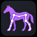
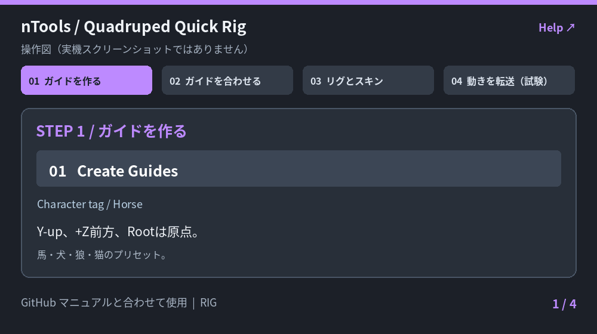

# Quadruped Quick Rig v2.4.0

[← nTools トップへ戻る](../../README.md)

馬・犬・狼・猫の四足動物向けガイド、変形用ジョイント、IK/FKコントローラ、スキニング、試験的なモーション転送を行うMayaツールです。

> **重要:** MotionMaker/HumanIKの正式キャラクター定義ではありません。モーション転送は試験的なFKベイクです。足の接地や歩幅の自動補正は行いません。必ずシーンを複製して試してください。

## クイックガイド（図解・GIF・動画）

ウィンドウ右上の **Help** からこのページを開けます。

[静止画 STEP 1](../media/quadruped/step-1.png) · [STEP 2](../media/quadruped/step-2.png) · [STEP 3](../media/quadruped/step-3.png) · [STEP 4](../media/quadruped/step-4.png) · [MP4動画を開く／ダウンロード](../media/quadruped/quick-guide.mp4)

> 図解・GIF・MP4は実際のソースコードのボタン名・設定に基づく操作説明です。Mayaの実機キャプチャや実行結果ではありません。

## 1. モデルを準備する

- Maya 2027を使用し、新規キャラクター用のシーンで作業します。
- 正面はワールド **+Z**、上は **+Y**、キャラクターの左側は **+X** に合わせます。
- モデルは自然な立ち姿勢とし、スケール1・シアーなしを前提とします。必要なTransformの整理はリグ構築前に行います。
- 地面の基準をワールド原点に合わせ、シーンを保存します。
- nToolsシェルフの **RIG** を押します。

## 2. 01 Create Guides / ガイド作成

1. `Character tag` に識別名を入力します（例：`Horse01`）。同じタグのガイドやリグを重複生成することはできません。
2. `Animal preset` から `Horse` / `Dog` / `Wolf` / `Cat` を選択します。
3. `01 Create Guides / ガイド作成` を押します。

31個のガイドが作成されます。プリセットは出発点であり、モデルに自動で完全適合するわけではありません。

## 3. 02 ガイド位置をモデルに合わせる

`ガイドグループを選択` やOutlinerでガイドを確認し、個別のロケータを移動します。

| ガイドの役割 | 位置 |
|---|---|
| root | 地面のワールド原点 (0,0,0) |
| pelvis | 骨盤の中心。rootとは別。 |
| spine1 / chest | 背骨中間 / 胸郭中心 |
| neck1 / neck2 / head / nose | 首の付け根・中間・頭・鼻先 |
| tail1 / tail2 / tail3 | 尻尾の付け根・中間・先端 |
| front hip / knee / ankle | 前脚の肩・肘・手根 |
| hind hip / knee / ankle | 後脚の股関節・膝・飛節 |
| paw / toe | 足先・つま先。馬の蹄も内部名はpaw。 |

左脚（L）を合わせてから `Mirror L → R / 左脚を右脚へミラー` で右脚へ反映します。非対称なキャラクターでは右脚を個別調整してください。`ガイド31個の正式名と配置説明を表示` でツール内の詳細ガイドを参照できます。

## 4. 03 Build Rig / リグ生成

1. ガイドの位置が正しいか、特に脚の関節が重なっていないか確認します。
2. `03 Build Rig / リグ生成` を実行します。
3. `リグ構造のチェック（簡易）` を実行します。
4. 全体コントローラ、胴体・脚のコントローラを動かして確認します。

リグのスケルトンは `QQR_<tag>_J_...` の名前で作成されます。ガイドは生成後に非表示になります。構造チェックはノードの存在などを確認するもので、変形品質やアニメーションの保証ではありません。

## 5. 04 Bind Selected Meshes / スキニング

1. スキニング対象のポリゴンメッシュを選択します。
2. `04 Bind Selected Meshes / スキニング` を実行します。
3. コントローラを動かし、Skin Weightを確認・調整します。すでにskinClusterがあるメッシュはスキップされます。

自動バインドだけで最終的な変形品質が完成するわけではありません。体や関節の変形を確認してください。

## 6. IK/FK切替

脚ごとのIK/FK属性はsettingsコントローラにあります（0 = FK、1 = IK）。初期値はIKです。

`補助機能：脚の IK / FK ポーズ合わせ` を展開し、`Side` と `Leg` を選んで `Match + Switch IK/FK` を押します。`キーを現在フレームに打つ` をONにすると現在フレームにキーを設定します。ポーズ合わせは近似のため、足の回転や接地を確認してください。

## 7. 05 MotionMakerからのアニメーション転送（試験）

1. MotionMakerで動きの付いた転送元ジョイント階層を別途用意します。HorseにはEquine、Dog/WolfにはCanineが推奨されます。
2. Outlinerで転送元のアニメーション付きルートジョイントを選択します。例：`moma:equine` 配下の `moma:pelvis`（実際の名前・階層は確認してください）。**QQR自身のターゲットジョイントを選ばないでください。**
3. `Source root joint` の `Use selected` を押し、`05-A Auto-map Source Joints / 対応名を推定` を実行します。
4. `Source Joint Mapping` を展開し、対応が正しいか確認します。必要なら元のジョイントを1つ選択して対応行の `Assign` を押すか、フィールドを修正します。同一ジョイントを複数の役割に割り当てないでください。
5. `Start frame` / `End frame` / `Reference frame` を設定します。Reference frameは転送元とターゲットの基準姿勢を比較するフレームです。`再生範囲を入力欄に反映` で再生範囲を利用できます。
6. `Frame step`（初期1）、`Root motion scale`（初期1.0）、`キャラクターの向き(+Z)を合わせる`（初期ON）を設定します。
7. `05-B Bake Motion to FK / 転送・Bake（試験）` を押します。
8. 再生して動作・足滑り・向き・姿勢を確認し、必要な補正を行います。

転送は指定範囲のターゲットの回転キー、root移動キー、IK/FK切替キーを置き換えるため、必ず別名保存してから実行してください。rootを含め最低8役割の有効なマッピングが必要です。転送元を変更すると対応表が消去されるので、再度Auto-mapしてください。

## 8. よくある問題

| 症状 | 対処 |
|---|---|
| Do not use target rig joints / QQR TARGET joint | QQRのJ_root等ではなくMotionMakerの元ジョイントを選択し、Use selected → Auto-mapをやり直す。 |
| ルートが地面からずれる | ガイドのrootを原点に配置。pelvisは骨盤内に配置。 |
| 左右が反対になる | +Z正面、+Xがキャラクター左であることを確認。 |
| 脚がねじれる・足が滑る | ガイドの位置と対応表、基準姿勢を再確認。FKベイク後に手動補正。 |
| 同じタグで作れない | 別タグを使用するか、新しいシーンで作り直す。 |

[← ツール一覧へ](../../README.md)
