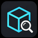

# Sketchfab Asset Browser v1.2

[← nTools トップへ戻る](../../README.md)

Sketchfabのダウンロード可能な3Dモデルを検索し、Mayaへ静的メッシュとして読み込み、OpenPBRマテリアルを設定するツールです。

## クイックガイド（図解・GIF・動画）

ウィンドウ右上の **Help** からこのページを開けます。

[静止画 STEP 1](../media/sketchfab/step-1.png) · [STEP 2](../media/sketchfab/step-2.png) · [STEP 3](../media/sketchfab/step-3.png) · [STEP 4](../media/sketchfab/step-4.png) · [MP4動画を開く／ダウンロード](../media/sketchfab/quick-guide.mp4)

> 図解・GIF・MP4は実際のソースコードのボタン名・設定に基づく操作説明です。Mayaの実機キャプチャや実行結果ではありません。

## 1. 準備

- Mayaで **File → Set Project** を実行し、シーンを保存します。
- インターネット接続とSketchfabアカウントを用意します。オンラインダウンロードには自分のAPIトークンが必要です。
- Arnold（MtoA）とOpenPBRを利用できるMaya環境を使用します。
- nToolsシェルフの **SF** をクリックします。

## 2. モデルを検索する

1. `API token` 欄に自分のトークンを入力します。未取得の場合は `Get your personal token (Sketchfab settings)` から設定ページを開きます。
2. `Search` 欄に英語のキーワードを入力します（例：`forest`、`rock`、`chair`）。
3. `Search` ボタンを押します。検索対象はダウンロード可能なモデルです。
4. `Thumbnail View` で画像一覧を確認します。通信が遅い場合は `List View (lightweight)` に切り替えると、選択したモデルのプレビューだけを読み込みます。
5. `Next page` で次の検索結果に進めます。
6. モデルを選択して、作者・ライセンス・プレビューを確認します。`Open selected model on Sketchfab` で元のページを開けます。

## 3. Mayaにインポートする

1. モデルを選択し、`Download & Import OpenPBR` を押します。
2. ライセンス確認画面を読み、利用条件を守れる場合だけ `Import` を選択します。
3. ダウンロード後、自動で静的メッシュ・UV・対応するテクスチャとOpenPBRマテリアルが作成されます。
4. ビューポートの表示、Hypershade、Arnold RenderViewで形状と質感を確認し、シーンを保存します。

ダウンロードデータはプロジェクトの `sourceimages/Sketchfab/<モデルUID>/` に保存されます。作者・ライセンスの情報は `ATTRIBUTION.txt` とインポートしたルートの `sketchfabAttribution` 属性に記録されます。作品公開時はライセンスの指定に従ってクレジットを表示してください。

## 4. ローカルのglTFを読み込む

`Import local .gltf (static, no login)` を押し、展開済みの `.gltf` ファイルを選択します。対応する `.bin` や画像ファイルも元の相対パスのまま置いてください。ローカル読み込みにAPIトークンは不要ですが、元データのライセンス確認は必要です。

## 5. 制限・よくある問題

| 症状 | 確認すること |
|---|---|
| ダウンロードできない | APIトークン、モデルのダウンロード権限、通信環境を確認。検索結果が表示されてもダウンロードできるとは限りません。 |
| サムネイルが遅い | `List View (lightweight)` を使用。 |
| リグ・アニメーションがない | 本版は静的glTF用です。スキン、アニメーション、モーフは転送されません。 |
| 読み込めないglTF | 非圧縮の三角形メッシュを対象としています。Draco圧縮、未対応の必須拡張、疎なアクセサ、UV0以外のマテリアルなどは非対応です。 |
| 見た目が元サイトと異なる | テクスチャ変換や一部のマテリアル拡張、頂点カラー、AOなどは省略・近似されます。Arnold側で調整してください。 |

APIトークンは他人に渡さず、GitHubや提出シーンの説明欄に貼らないでください。Sketchfabのすべての作品が自由利用できるわけではありません。

[← ツール一覧へ](../../README.md) · [PolyHaven Asset Browser →](polyhaven.md)
