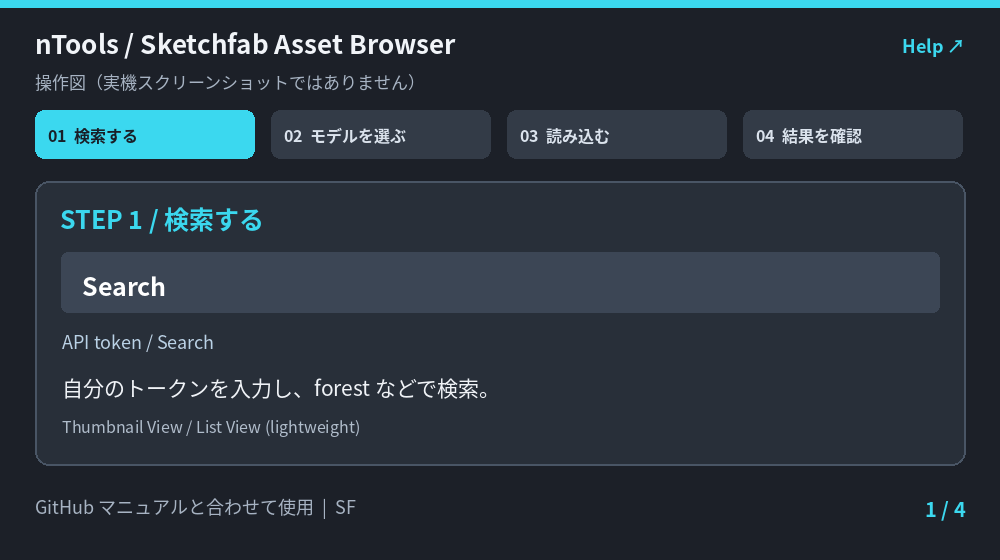

# Sketchfab Asset Browser v1.3.1

[← nTools トップへ戻る](../../README.md)

Sketchfabのダウンロード可能な3Dモデルを検索し、Mayaへ静的メッシュとして読み込み、OpenPBRマテリアルを設定するツールです。v1.3で旧式のSpecular-Glossinessマテリアルの自動変換、v1.3.1でSet Project確認に対応しました。

## クイックガイド（図解・GIF・動画）

ウィンドウ右上の **Help** からこのページを開けます。

[静止画 STEP 1](../media/sketchfab/step-1.png) · [STEP 2](../media/sketchfab/step-2.png) · [STEP 3](../media/sketchfab/step-3.png) · [STEP 4](../media/sketchfab/step-4.png) · [MP4動画を開く／ダウンロード](../media/sketchfab/quick-guide.mp4)

> 図解・GIF・MP4は実際のソースコードのボタン名・設定に基づく操作説明です。Mayaの実機キャプチャや実行結果ではありません。

## 1. 準備

- Mayaで **File → Set Project** を実行し、シーンを保存します。
- インターネット接続とSketchfabアカウントを用意します。オンラインダウンロードには自分のAPIトークンが必要です。
- Arnold（MtoA）とOpenPBRを利用できるMaya環境を使用します。
- nToolsシェルフの **SF** をクリックします。

## 2. モデルを検索する

1. `API token` 欄に自分のトークンを入力します。未取得の場合は `Get your personal token (Sketchfab settings)` から設定ページを開きます。
2. `Search` 欄に英語のキーワードを入力します（例：`forest`、`rock`、`chair`）。
3. `Search` ボタンを押します。検索対象はダウンロード可能なモデルです。
4. `Thumbnail View` で画像一覧を確認します。通信が遅い場合は `List View (lightweight)` に切り替えると、選択したモデルのプレビューだけを読み込みます。
5. `Next page` で次の検索結果に進めます。
6. モデルを選択して、作者・ライセンス・プレビューを確認します。`Open selected model on Sketchfab` で元のページを開けます。

## 3. Mayaにインポートする

1. モデルを選択し、`Download & Import OpenPBR` を押します。
2. ライセンス確認画面を読み、利用条件を守れる場合だけ `Import` を選択します。
3. **「Set Projectの確認」** で現在のプロジェクトパスを確認し、正しければ **はい** を押します。間違っていれば **いいえ（中止）** を選び、Mayaの **File → Set Project** を実行してから再試行します。
4. ダウンロード後、自動で静的メッシュ・UV・対応するテクスチャとOpenPBRマテリアルが作成されます。
5. ビューポートの表示、Hypershade、Arnold RenderViewで形状と質感を確認し、シーンを保存します。

ダウンロードデータはプロジェクトの `sourceimages/Sketchfab/<モデルUID>/` に保存されます。作者・ライセンスの情報は `ATTRIBUTION.txt` とインポートしたルートの `sketchfabAttribution` 属性に記録されます。作品公開時はライセンスの指定に従ってクレジットを表示してください。

## 4. ローカルのglTFを読み込む

`Import local .gltf (static, no login)` を押し、展開済みの `.gltf` ファイルを選択すると、Set Project確認が表示されます。正しいプロジェクトが選ばれている場合のみ **はい** を押してください。対応する `.bin` や画像ファイルも元の相対パスのまま置いてください。ローカル読み込みにAPIトークンは不要ですが、元データのライセンス確認は必要です。

### Set Project確認について（v1.3.1）

- PolyHaven Asset Browser・Material Creatorと同じ文面で、現在のMayaプロジェクトパスを表示します。
- **はい**：インポートを続行。**いいえ（中止）**：インポートを始めずに戻ります。
- **次のツール起動時まで表示しない**：同一ウィンドウ・同一プロジェクト内でのみ確認を省略します。ウィンドウを開き直すかプロジェクトを変更すると再確認します。
- この確認は **Set Projectを実行した履歴を自動検証する機能ではありません**。表示されたプロジェクトが正しいか必ず確認してください。
- オンラインアセットは現在のプロジェクト内へ保存しますが、**ローカルglTFの元ファイル・画像は自動的にプロジェクト内へコピーされません**。外部依存に注意し、必要に応じてデータ集合ツールなどで整理してください。

## 5. Specular-Glossiness の自動変換（v1.3 新機能）

Sketchfabの一部モデルでは、glTFに `KHR_materials_pbrSpecularGlossiness` が含まれており、旧v1.2では「Unsupported required glTF extensions」と表示されていました。v1.3では、この方式を検出すると自動でOpenPBR用の **Metallic-Roughness** マップへ変換します。

- `diffuseFactor` / Diffuseテクスチャ（RGB・透明度）を読み込みます。
- `specularFactor` とSpecular-Glossinessテクスチャの **RGB（Specular）** を読み込みます。
- `glossinessFactor` とSpecular-Glossinessテクスチャの **A（Glossiness）** を使い、`Roughness = 1 − Glossiness` で変換します。
- 色の計算はリニア空間で行い、OpenPBR用のBase Color（sRGB画像）とMetallic / Roughness（Raw画像）を生成・接続します。
- Alpha Mode（MASK / BLEND）およびDiffuse側の透明度を維持するようにしています。
- 変換後の画像は、現在のMayaプロジェクト内の `sourceimages/Sketchfab/_converted_specgloss/` にキャッシュします。生成した画像は元データを上書きしません。

**ご注意：** 異なるマテリアルモデル間の変換は近似です。特に色付き鏡面反射、特殊な誘電体反射、複雑なマテリアルではSketchfab上の見た目と完全一致しません。高解像度画像はメモリ保護のため最大約2Kへ縮小します。異なるUVセット、Texture Transform、異なるラップ方式、Draco圧縮、KTX2などの未対応方式は安全のためインポートを中止し、エラー内容を表示します。現状、Static glTFのみの対応です。

> 参照仕様：[Khronos — KHR_materials_pbrSpecularGlossiness](https://github.com/KhronosGroup/glTF/blob/main/extensions/2.0/Archived/KHR_materials_pbrSpecularGlossiness/README.md)

## 6. 制限・よくある問題

| 症状 | 確認すること |
|---|---|
| ダウンロードできない | APIトークン、モデルのダウンロード権限、通信環境を確認。検索結果が表示されてもダウンロードできるとは限りません。 |
| サムネイルが遅い | `List View (lightweight)` を使用。 |
| リグ・アニメーションがない | 本版は静的glTF用です。スキン、アニメーション、モーフは転送されません。 |
| 読み込めないglTF | 非圧縮の三角形メッシュが対象です。Specular-Glossinessは対応しましたが、Draco圧縮、未対応の必須拡張、疎なアクセサ、UV0以外のマテリアルなどは非対応です。 |
| 見た目が元サイトと異なる | Specular-GlossinessはMetallic-Roughnessへ近似変換します。一部のマテリアル拡張、頂点カラー、AOなどは省略・近似されます。Arnold側で調整してください。 |

APIトークンは他人に渡さず、GitHubや提出シーンの説明欄に貼らないでください。Sketchfabのすべての作品が自由利用できるわけではありません。

[← ツール一覧へ](../../README.md) · [PolyHaven Asset Browser →](polyhaven.md)
